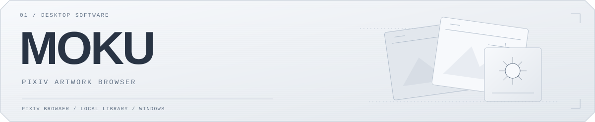
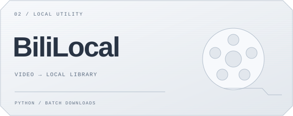
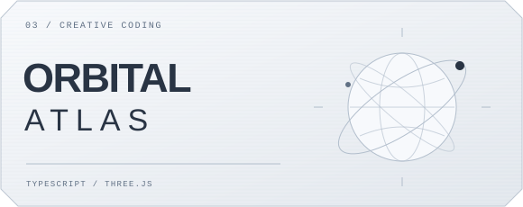
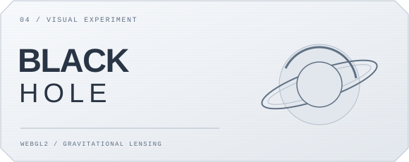

<picture>
  <source media="(prefers-color-scheme: dark)" srcset="./assets/hero-dark.svg" />
  <source media="(prefers-color-scheme: light)" srcset="./assets/hero-light.svg" />
  
</picture>

 

  
  
  
  

Building desktop tools and visual experiments with Python and TypeScript.

<a href="https://github.com/Xirti?tab=repositories">Repositories</a> · <a href="https://xirti.github.io/Carrot/">Orbital Atlas</a> · <a href="https://xirti.github.io/blackhole/">Black Hole</a>

### `// SELECTED_WORK` · Selected work

<table width="100%" cellpadding="10" cellspacing="0">
  <tr>
    <td colspan="3" valign="top">
      <code>FLAGSHIP / 01</code>
      <a href="https://github.com/Xirti/Pixiv-Bulk-Image-Downloader">
        <picture>
  <source media="(prefers-color-scheme: dark)" srcset="./assets/project-moku-dark.svg" />
  <source media="(prefers-color-scheme: light)" srcset="./assets/project-moku-light.svg" />
  
</picture>
      </a>
      
<strong>A local-first Windows app for browsing and collecting Pixiv artwork.</strong>

      
<code>Python</code> <code>Windows</code> <code>Pixiv</code>

      
<a href="https://github.com/Xirti/Pixiv-Bulk-Image-Downloader">Repository</a> · <a href="https://github.com/Xirti/Pixiv-Bulk-Image-Downloader/releases">Releases</a>

    </td>
  </tr>
  <tr>
    <td width="33%" valign="top">
      <code>LOCAL TOOLS / 02</code>
      <a href="https://github.com/Xirti/BiliBili-downloader">
        <picture>
  <source media="(prefers-color-scheme: dark)" srcset="./assets/project-bililocal-dark.svg" />
  <source media="(prefers-color-scheme: light)" srcset="./assets/project-bililocal-light.svg" />
  
</picture>
      </a>
      
<strong>A local Bilibili downloader with batch tasks and media merging.</strong>

      
<code>Python</code> <code>FFmpeg</code>

      
<a href="https://github.com/Xirti/BiliBili-downloader">Repository</a> · <a href="https://github.com/Xirti/BiliBili-downloader/releases">Releases</a>

    </td>
    <td width="33%" valign="top">
      <code>CREATIVE CODING / 03</code>
      <a href="https://github.com/Xirti/Carrot">
        <picture>
  <source media="(prefers-color-scheme: dark)" srcset="./assets/project-orbital-dark.svg" />
  <source media="(prefers-color-scheme: light)" srcset="./assets/project-orbital-light.svg" />
  
</picture>
      </a>
      
<strong>An interactive 3D Solar System built with Three.js.</strong>

      
<code>TypeScript</code> <code>Three.js</code>

      
<a href="https://github.com/Xirti/Carrot">Repository</a> · <a href="https://xirti.github.io/Carrot/">Live demo</a>

    </td>
    <td width="33%" valign="top">
      <code>VISUAL EXPERIMENT / 04</code>
      <a href="https://github.com/Xirti/blackhole">
        <picture>
  <source media="(prefers-color-scheme: dark)" srcset="./assets/project-blackhole-dark.svg" />
  <source media="(prefers-color-scheme: light)" srcset="./assets/project-blackhole-light.svg" />
  
</picture>
      </a>
      
<strong>A WebGL2 experiment in black holes and gravitational lensing.</strong>

      
<code>WebGL2</code> <code>GLSL</code>

      
<a href="https://github.com/Xirti/blackhole">Repository</a> · <a href="https://xirti.github.io/blackhole/">Live demo</a>

    </td>
  </tr>
</table>

 

### `// CONTRIBUTION_SNAKE` · Contribution signal

One contribution at a time.

<picture>
  <source media="(prefers-color-scheme: dark)" srcset="./assets/snake-dark.svg" />
  <source media="(prefers-color-scheme: light)" srcset="./assets/snake-light.svg" />
  
</picture>

 
 

<picture>
  <source media="(prefers-color-scheme: dark)" srcset="./assets/footer-dark.svg" />
  <source media="(prefers-color-scheme: light)" srcset="./assets/footer-light.svg" />
  
</picture>

